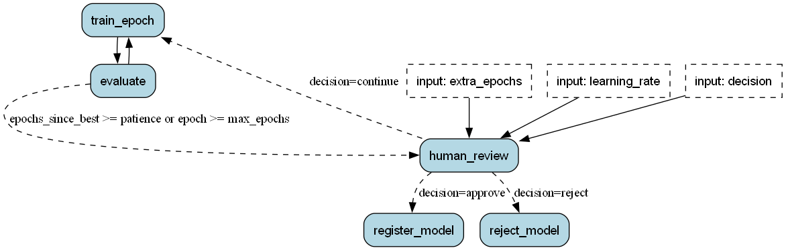

<!--
     Licensed to the Apache Software Foundation (ASF) under one
     or more contributor license agreements.  See the NOTICE file
     distributed with this work for additional information
     regarding copyright ownership.  The ASF licenses this file
     to you under the Apache License, Version 2.0 (the
     "License"); you may not use this file except in compliance
     with the License.  You may obtain a copy of the License at

       http://www.apache.org/licenses/LICENSE-2.0

     Unless required by applicable law or agreed to in writing,
     software distributed under the License is distributed on an
     "AS IS" BASIS, WITHOUT WARRANTIES OR CONDITIONS OF ANY
     KIND, either express or implied.  See the License for the
     specific language governing permissions and limitations
     under the License.
-->

# ML training

This example trains a model one epoch at a time. Burr runs the training as a state machine. A person approves the model before the example registers it.

The example uses scikit-learn and its built-in digits dataset, so it needs no API key and no download. The full code, a notebook, and a test are in the [repository](https://github.com/apache/burr/tree/main/examples/ml-training).



## Why a state machine

A training pipeline is frequently a DAG, for example `query_data` -> `feature_engineer` -> `train_model` -> `evaluate_model`. A state machine gives you more when you make each epoch an action:

- Checkpoints: Burr saves the state after each epoch, so a failed run continues at the next epoch.
- A separate stop rule: A transition condition decides when the training stops. The training code does not change when the stop rule changes.
- Visibility: Burr tracks each epoch, so you can see the metrics in the Burr UI during the training.
- Human review: The application halts before the review and continues when a person gives a decision.

## The actions

`train_epoch` trains for one epoch and saves a checkpoint file. `evaluate` scores that checkpoint and records the best one. The state holds the metrics and the paths of the checkpoint files. The models stay on disk, so the state is small and Burr can save it as JSON.

```python
@action(
    reads=["epoch", "learning_rate", "checkpoint_dir", "latest_checkpoint"],
    writes=["epoch", "latest_checkpoint"],
)
def train_epoch(state: State) -> State:
    """Runs one epoch, starting from the latest checkpoint, and saves a new checkpoint."""
    X_train, _, y_train, _ = load_data()
    if state["latest_checkpoint"]:
        model = joblib.load(state["latest_checkpoint"])
    else:
        model = SGDClassifier(loss="log_loss", learning_rate="constant", random_state=0)
    # set every epoch, because the reviewer can change it
    model.set_params(eta0=state["learning_rate"])
    epoch = state["epoch"] + 1
    order = np.random.default_rng(epoch).permutation(len(X_train))
    model.partial_fit(X_train[order], y_train[order], classes=np.unique(y_train))

    os.makedirs(state["checkpoint_dir"], exist_ok=True)
    checkpoint = os.path.join(state["checkpoint_dir"], f"epoch_{epoch}.joblib")
    joblib.dump(model, checkpoint)
    return state.update(epoch=epoch, latest_checkpoint=checkpoint)
```

## The stop rule

The stop rule is the condition on the transition from `evaluate` to `human_review`. To use a different rule, change that one line.

```python
.with_transitions(
    ("train_epoch", "evaluate", default),
    ("evaluate", "human_review", expr("epochs_since_best >= patience or epoch >= max_epochs")),
    ("evaluate", "train_epoch", default),
    ("human_review", "train_epoch", when(decision="continue")),
    ("human_review", "register_model", when(decision="approve")),
    ("human_review", "reject_model", when(decision="reject")),
)
```

## Human in the loop

The decision of the reviewer is an [input](https://burr.apache.org/concepts/actions/#runtime-inputs) of the `human_review` action. The action cannot run until a person gives a decision.

```python
@action(
    reads=["epoch", "learning_rate"],
    writes=["decision", "max_epochs", "epochs_since_best", "learning_rate"],
)
def human_review(
    state: State, decision: str, extra_epochs: int = 5, learning_rate: Optional[float] = None
) -> State:
    ...

app.run(halt_before=["human_review"])  # trains, then stops before the review
app.run(halt_after=["register_model", "reject_model"], inputs={"decision": "approve"})
```

A persister saves the state after each step. As a result, the process can exit at the review. When the person replies, a scheduler or a web request builds the application again with the same `app_id`, and the run continues at the review.

## Hyperparameter tuning

The reviewer can change one hyperparameter at the review: the learning rate. When the decision is `continue`, an optional input named `learning_rate` gives the new value. The action writes it to the state, and `train_epoch` uses it from the next epoch.

```python
app.run(halt_before=["human_review"], inputs={"decision": "continue", "learning_rate": 0.01})
```

This example does not include an automatic hyperparameter search. You can model one in the same way. An action takes the place of the reviewer. It reads the earlier results from the state and selects the next parameters to try.
