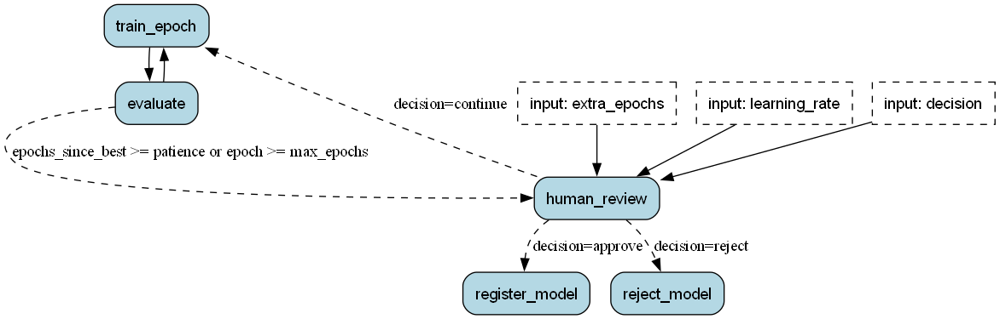

<!--
     Licensed to the Apache Software Foundation (ASF) under one
     or more contributor license agreements.  See the NOTICE file
     distributed with this work for additional information
     regarding copyright ownership.  The ASF licenses this file
     to you under the Apache License, Version 2.0 (the
     "License"); you may not use this file except in compliance
     with the License.  You may obtain a copy of the License at

       http://www.apache.org/licenses/LICENSE-2.0

     Unless required by applicable law or agreed to in writing,
     software distributed under the License is distributed on an
     "AS IS" BASIS, WITHOUT WARRANTIES OR CONDITIONS OF ANY
     KIND, either express or implied.  See the License for the
     specific language governing permissions and limitations
     under the License.
-->

# ML Training

This example trains a model one epoch at a time. Burr runs the training as a state machine, which is a set of steps with rules for the next step. A person approves the model before the example registers it.

The example uses scikit-learn and its built-in digits dataset. It needs no API key and no download. One run takes a few seconds.



The example has four files:

- [application.py](application.py): The actions, the state machine, and a command-line loop.
- [notebook.ipynb](notebook.ipynb): The same run, one step at a time.
- [test_ml_training.py](test_ml_training.py): A test that runs the full flow without a person.
- [requirements.txt](requirements.txt): The packages that the example needs.

## Run the example

Run these commands from this directory.

1. Install the packages:

   ```bash
   pip install -r requirements.txt
   ```

2. Start a run:

   ```bash
   python application.py
   ```

   The program prints an `app_id`, which is the identifier of this run. The program trains until the stop rule is true. Then it prints why it stopped, the best score, the last 5 scores, and the learning rate. Then it asks for a decision.

3. Type one of the three decisions:

   - `approve`: The program copies the best checkpoint to `checkpoints/<app_id>/model.joblib`.
   - `continue`: The program asks for a learning rate. Press Enter to keep the current value. Then the program trains for a maximum of 5 more epochs and asks again.
   - `reject`: The program stops and registers no model.

To see each step in the Burr UI, run `burr` in a second terminal. The run is in the project `demo_ml_training`.

## Stop a run and resume it

Burr saves the state after each step in `ml_training.db`, which is a SQLite file in this directory. If you stop the program at the question, you do not lose the run.

To resume the run, give its `app_id` to the program:

```bash
python application.py <app_id>
```

The program does not train again. It continues at the review and asks for the decision. If the program fails during training, the same command continues at the next epoch.

A real review works the same way. The process exits at the review. When the person replies, a scheduler or a web request starts the process again with the `app_id` and the decision.

## How it works

### One epoch is one action

`train_epoch` trains the model for one epoch and saves it to a checkpoint file. `evaluate` scores that checkpoint on the validation data and records the best checkpoint. Because each epoch is a separate step, Burr saves the state and tracks the metrics after each epoch.

### The state holds paths, not models

The state holds the metrics, the counters, and the paths of the checkpoint files. The models stay on disk. As a result, the state is small and Burr can save it as JSON.

Each run writes to its own directory, `checkpoints/<app_id>/`. The example does not delete old checkpoints.

### The stop rule is a transition

The training code does not decide when to stop. One transition holds the stop rule:

```python
("evaluate", "human_review", expr("epochs_since_best >= patience or epoch >= max_epochs")),
```

To use a different stop rule, change this line. The actions stay the same. The default values are `patience=3` and `max_epochs=20`, and you can set them in `application()`.

### The review is an input

The application halts before the `human_review` action. That action needs an input named `decision`, so it cannot run until a person gives one.

When the decision is `continue`, the action raises `max_epochs` by `extra_epochs` and sets `epochs_since_best` to 0. Training then continues with the same stop rule.

## Hyperparameter tuning

The reviewer can change one hyperparameter at the review: the learning rate. The `human_review` action has an optional input named `learning_rate`. When the decision is `continue`, the action writes the new value to the state, and `train_epoch` uses it from the next epoch.

```python
app.run(halt_before=["human_review"], inputs={"decision": "continue", "learning_rate": 0.01})
```

The default learning rate is 0.001, and the accuracy rises slowly with it. To see the effect, continue a run with 0.01. The accuracy rises faster in the next epochs.

This example does not include an automatic hyperparameter search. You can model one in the same way. An action takes the place of the reviewer. It reads the earlier results from the state and selects the next parameters to try.
