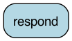

<!--
     Licensed to the Apache Software Foundation (ASF) under one
     or more contributor license agreements.  See the NOTICE file
     distributed with this work for additional information
     regarding copyright ownership.  The ASF licenses this file
     to you under the Apache License, Version 2.0 (the
     "License"); you may not use this file except in compliance
     with the License.  You may obtain a copy of the License at

       http://www.apache.org/licenses/LICENSE-2.0

     Unless required by applicable law or agreed to in writing,
     software distributed under the License is distributed on an
     "AS IS" BASIS, WITHOUT WARRANTIES OR CONDITIONS OF ANY
     KIND, either express or implied.  See the License for the
     specific language governing permissions and limitations
     under the License.
-->

# Stopping a streaming action early

Streaming actions often hold something open while they stream, such as an HTTP connection to an LLM, a
database cursor, or a tracing span. They release it in a `finally` block or a `with` exit. When you stop
reading a stream before it ends (the user hits "stop", a moderation check trips, a token budget runs out,
the client disconnects), Burr:

1. **runs the action's cleanup right away**, not whenever the garbage collector gets to it;
2. **then reports the step as failed** to hooks, trackers and persisters, so resuming the application
   re-runs it (on a web-server [client disconnect](#web-servers-client-disconnects), async hooks and
   persisters don't get to run, but resuming still re-runs the step);
3. **doesn't update the state**, so a half-finished response is never committed.

All you have to do is stop iterating the way you would with any Python generator:

| | do this |
|---|---|
| sync | `break` |
| async | `break` inside `async with contextlib.aclosing(...)` |
| web server | the async pattern; the server cancels your task when the client disconnects |

Don't mix sync and async: async applications should use async hooks and persisters, as the async demos do.

Every demo in [application.py](application.py) prints a timeline of what happened, so you can see
when the resource is released and what Burr reports. Run it with:

```bash
python application.py
```



## Sync: just `break`

```python
action, container = app.stream_result(halt_after=["respond"])
for item in container:
    send_to_user(item["token"])
    if wants_to_stop(item):
        break  # the action's cleanup runs here, then the step is reported

result, state = container.get()  # (None, state without the update)
```

```
respond: open LLM connection
caller: got 'Burr '
caller: got 'streams '
caller: got 'tokens '
respond: close LLM connection                       <- at the break
post_run_step: respond failed with GeneratorExit()
caller: after the loop
```

Breaking out of `app.stream_iterate(...)` works the same way.

## Async: `break` inside `contextlib.aclosing`

```python
import contextlib

action, container = await app.astream_result(halt_after=["respond"])
async with contextlib.aclosing(container):
    async for item in container:
        if wants_to_stop(item):
            break
# cleanup has run and the step has been reported

async with contextlib.aclosing(app.astream_iterate(halt_after=["respond"])) as steps:
    async for action, container in steps:
        async for item in container:
            ...
```

Why the extra `async with`? Python can't run an async generator's cleanup at the `break`, because the
cleanup may need to `await`. Without `aclosing`, Python hands it to the event loop, which runs it at some
later point, after your code has moved on (`async_break_without_aclose_demo`):

```
respond: open LLM connection
caller: after the loop -- nothing has been cleaned up yet
respond: close LLM connection                       <- whenever the event loop gets to it
post_run_step: respond failed with GeneratorExit()
```

`await container.aclose()` after the loop does the same as `aclosing`, if you prefer it.

## Cancelling the consuming task

**To stop a stream from somewhere else** (another task, a "stop" endpoint), cancel the task that is
consuming it (`cancel_task_demo`). The action is cleaned up and hooks receive `CancelledError`:

```
respond: open LLM connection
caller: got 'Burr '
caller: got 'streams '
caller: task.cancel()
respond: close LLM connection
post_run_step: respond failed with CancelledError()
```

Calling `close()` / `aclose()` while the stream is producing an item (from another task, or from inside
a hook) raises a `RuntimeError` that tells you to cancel the task instead.

## Web servers: client disconnects

When a client disconnects, ASGI servers such as Starlette/FastAPI *cancel* the code that is
producing the response. If your response generator uses the async pattern, that cancellation unwinds
the Burr action immediately. See [server.py](server.py):

```python
@app.get("/chat")
async def chat():
    async def sse():
        async with contextlib.aclosing(burr_app.astream_iterate(halt_after=["respond"])) as steps:
            async for _, container in steps:
                async for item in container:
                    yield f"data: {item['token']}\n\n"
    return StreamingResponse(sse(), media_type="text/event-stream")
```

```bash
uvicorn server:app
curl -N --max-time 1 localhost:8000/chat     # hang up after a second
# server log:
#   respond: open LLM connection
#   respond: close LLM connection
```

There is no `post_run_step` line. Starlette cancels through an anyio *cancel scope*. Unlike
`task.cancel()`, a cancel scope keeps cancelling every `await` inside it, including Burr's await on async
`post_run_step` hooks and async persisters. So for a disconnected step:

- the action's cleanup **starts**, but an `await` inside it is cancelled too, as for any code under a
  cancelled scope. Wrap cleanup that must finish (e.g. releasing a connection) in
  `anyio.CancelScope(shield=True)`:

  ```python
  finally:
      with anyio.CancelScope(shield=True):
          await connection.release()
  ```

- async hooks, trackers and persisters **don't** run, so the stopped step isn't recorded;
- **resuming is unaffected**: the last saved step is the one before, so the interrupted action runs again,
  as it would if it had been saved as `failed`.

`client_disconnect_demo` reproduces this without a server:

```
respond: open LLM connection
server: sent 'Burr '
server: sent 'streams '
server: client disconnected -> cancel the response
respond: close LLM connection
persister: saved for this run: None
resume: next action is 'respond' (it runs again)
```

## What gets reported

| How the stream ended | `post_run_step(exception=...)` | persister status | state updated? | on resume |
|---|---|---|---|---|
| read to the end | `None` | `completed` | yes | next action |
| `break` / `close()` / `aclose()` before the end | `GeneratorExit()` | `failed` | no | **same action runs again** |
| consuming task cancelled (`task.cancel()`) | `CancelledError()` | `failed` | no | **same action runs again** |
| client disconnect (Starlette/FastAPI cancel scope) | async hooks not called | nothing saved | no | **same action runs again** |
| the action raised | that exception | `failed` | no | same action runs again |
| stopped early, and the action's cleanup raised | the cleanup error | `failed` | no | same action runs again |

So in a `post_run_step` hook, `exception is not None` means "this step did not complete". To tell a
deliberate stop apart from a real failure:

```python
def post_run_step(self, *, exception, **kwargs):
    if exception is None:
        ...  # completed
    elif isinstance(exception, (GeneratorExit, asyncio.CancelledError)):
        ...  # stopped early by the caller / client
    else:
        ...  # a real error
```

Note that `GeneratorExit` and `CancelledError` derive from `BaseException`, not `Exception`.

## Things to know

- **Errors while stopping: the first one wins.** If the action's `finally` raises while it is being stopped,
  hooks receive that error, and `close()` / `aclose()` raise it (`cleanup_error_demo`). Otherwise, an error
  from a `post_run_step` hook is raised. Every later `close()` / `aclose()` raises the same error. A `break`
  itself doesn't raise; Burr logs a warning and `close()` / `aclose()` raise it afterwards. An error raised
  while stopping never replaces an error that was already stopping the stream (such as a bug in a hook); it is
  logged instead.
- **Client disconnects aren't recorded by async hooks or persisters** (see [above](#web-servers-client-disconnects)).
  Don't work around it by adding sync hooks to an async app: they block the event loop. Resume is
  correct either way.

See also the [streaming actions docs](https://burr.apache.org/concepts/streaming-actions/) and the
[streaming-fastapi](../streaming-fastapi) example for a full chatbot.
